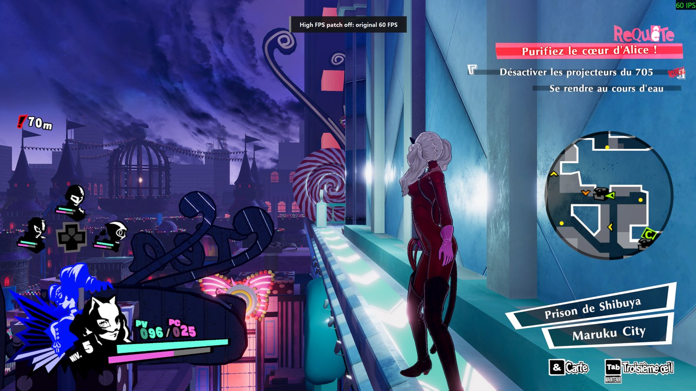
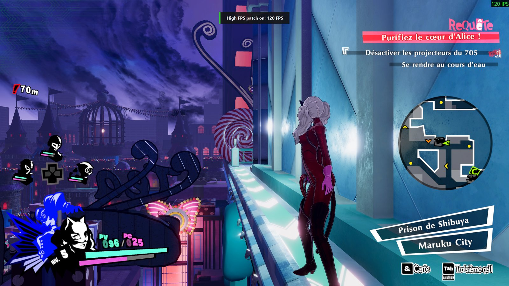
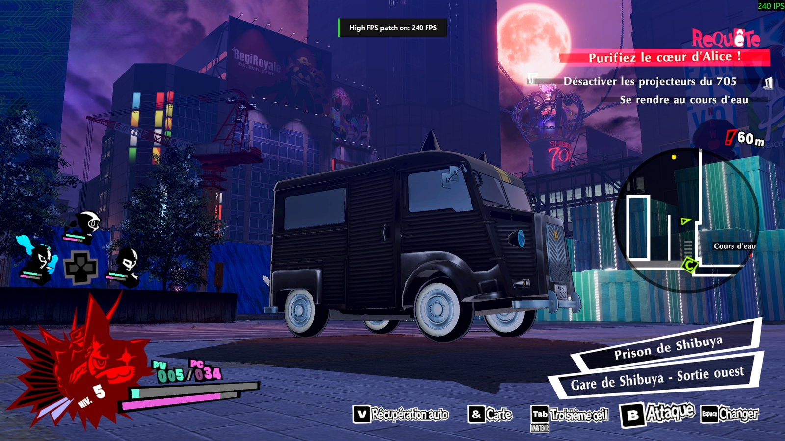

# P5SHighFps: Persona 5 Strikers at 120 FPS without speed-up

Persona 5 Strikers on PC is locked to 60 FPS, and its game logic is tied to the frame rate: simply raising the cap
makes everything run faster. **P5SHighFps** patches the game in memory so it renders at 120 FPS (or another target)
while gameplay, animations, timers and UI keep their normal speed.

- 120 FPS (configurable) with correct game speed
- Fixes the side effects older frame unlockers left behind: too-fast eye blinking, too-fast dialogue bubbles and
  UI animations, integer timers, NPCs disappearing depending on the camera, the Persona model flickering on the
  Persona screen, falling off zipline cables
- Nothing on disk is modified: it patches memory and verifies every instruction before touching it
- F8 toggles 120 FPS / original 60 FPS at any time, with an on-screen notification and beeps
- Starts automatically with the game through Steam launch options

| Patch off: original 60 FPS | Patch on: 120 FPS |
|---|---|
|  |  |

Same scene, toggled in game with F8. The banner at the top is the patcher's notification; the counter in the top-right
corner is an external FPS overlay.

Experimental: other targets work in principle (`--fps=N`, 30 to 360). Here at 240 FPS (`--fps=240`), briefly tested:



## Requirements

- **Persona 5 Strikers, Steam version 1.03** (`game.exe` built 2021-09-28). Any other version is detected and left
  untouched: the patcher shows an error and the game runs normally at 60 FPS.
- **Windows 10/11 x64** with the **[.NET 10 Desktop Runtime (x64)](https://dotnet.microsoft.com/download/dotnet/10.0)**.
  If it is missing, Windows shows a prompt with a download link the first time you run the patcher.
- A PC that can hold the target frame rate. Like the original game at 60 FPS, dropping below the target slows the
  game down instead of skipping frames.

## Installation

1. Download `P5SHighFps.exe` from the [Releases](../../releases) page and check its SHA256 (see below).
   It is also available on [GameBanana](https://gamebanana.com/tools/24455) as a zip ready to extract into the game
   folder.
2. Create a folder named `P5SHighFps` in the game folder, for example
   `C:\Program Files (x86)\Steam\steamapps\common\P5S\P5SHighFps\`, and put `P5SHighFps.exe` in it.
3. In Steam, right-click Persona 5 Strikers → **Properties** → **General** → **Launch options**, and paste
   (adjusting the path to your install):

   ```
   "C:\Program Files (x86)\Steam\steamapps\common\P5S\P5SHighFps\P5SHighFps.exe" --auto=30 %command%
   ```

4. In the game options, set the frame rate to **60 FPS**, **turn V-Sync off**, and use **borderless/windowed** mode
   (needed for the on-screen notification; beeps work in any mode).

> [!IMPORTANT]
> **V-Sync must be off** in the game options. With V-Sync on, the game waits for the display and cannot hold the
> target frame rate, and every missed frame slows the game down. G-Sync / FreeSync and a display refresh rate at
> or above the target (120 Hz or more) are fine.
5. Launch the game from Steam. A console window opens next to the game; after 30 seconds you hear two high beeps and
   see a green "High FPS patch on" banner. Leave the console window open; it closes with the game.

To uninstall, clear the launch options. Nothing else was changed.

### Verifying the download

In PowerShell:

```powershell
Get-FileHash .\P5SHighFps.exe -Algorithm SHA256
```

The result must match the hash published with the release (`SHA256SUMS.txt`).

## Usage

| Key | Action |
|---|---|
| **F8** | Toggle the patch: 120 FPS (two high beeps, green banner) ↔ original 60 FPS (one low beep, grey banner) |

The game pauses when it loses focus, so keys are read globally while the game window is active. Only F8 is used.

### Options

| Option | Effect |
|---|---|
| `--auto=SECONDS` | Activate automatically SECONDS after the game starts (otherwise press F8 once in game) |
| `--fps=N` | Target frame rate, 30 to 360 (default 120). Tested at 120. |
| `--no-int-ticks` | Disable the integer counter fixes (eye blinking, integer timers); only for troubleshooting |
| `--now` | Patch immediately when started manually on an already running game |
| `--diagnostics` | Developer diagnostics on F5/F6/F7 (see [docs/TECHNICAL.md](docs/TECHNICAL.md)) |

## Troubleshooting

- **Long low beep and orange banner**: the patch was not applied. The reason is in `P5SHighFps.log`, next to the exe.
  The most common one is an unsupported game version.
- **The game runs in slow motion**: turn V-Sync off in the game options, and check that your PC holds the target
  frame rate (the log reports the actual rate every 5 seconds as `frames: 120.0/s`).
- **No banner but beeps work**: the game runs in exclusive fullscreen; switch to borderless.
- **Something looks too fast or too slow**: press F8 to compare with the original behaviour, then open an issue with
  `P5SHighFps.log` and a description of where it happens.
- **Antivirus warning**: the patcher opens the game process and writes to its memory, which some antivirus
  heuristics flag. The full source code is in this repository; you can build it yourself (see below) and compare the
  hash.

A healthy log contains lines like:

```
81/81 simulation step sites verified.
UI fixed-step animations: step scaled.
Short looping motions: time snapped to whole frames.
Integer counters: 24/24 calls redirected to a fixed divisor of 1.
Eye blinking: frame step replaced by the divisor.
```

## Compatibility

- Works alongside [P5StrikersFix](https://codeberg.org/Lyall/P5StrikersFix) (resolution, ultrawide, FOV), which is
  independent from this patcher.
- Single-player game, offline: there is no anti-cheat involved.

## How it works

The engine advances game time by a frame divisor (1 at 60 FPS) read by hundreds of places in the code. The patcher
replaces the floating-point uses of that divisor with 60/target (0.5 at 120 FPS), turns the integer uses into a
"1, 0, 1, 0..." tick sequence driven by a once-per-frame hook, and fixes a few systems that count frames on their own
(eye blinking, UI animation players). Details, addresses and the research tools are in
[docs/TECHNICAL.md](docs/TECHNICAL.md).

## Building from source

Requires the .NET 10 SDK.

```
cd src/P5SHighFps
dotnet publish -c Release -o ../../release/P5SHighFps
```

The build is deterministic and embeds no local paths.

## Support

P5SHighFps is free and will stay free. If it improved your playthrough and you want to say thanks, you can buy me a
coffee on **[Ko-fi](https://ko-fi.com/jutsusenseii)**. Bug reports and feedback in the issues help just as much.

## Credits

- **zettozoid** for the original "Static FPS Cap Changer" / "FPS++" cheat tables for v1.02, which identified the frame
  divisor and most of the floating-point step sites this patcher builds on.
- **Lyall** for P5StrikersFix.

## License and disclaimer

[MIT](LICENSE). This project is not affiliated with or endorsed by ATLUS, SEGA, KOEI TECMO or Omega Force. It
contains no game code or assets, only addresses and the bytes it patches. Use at your own risk.
